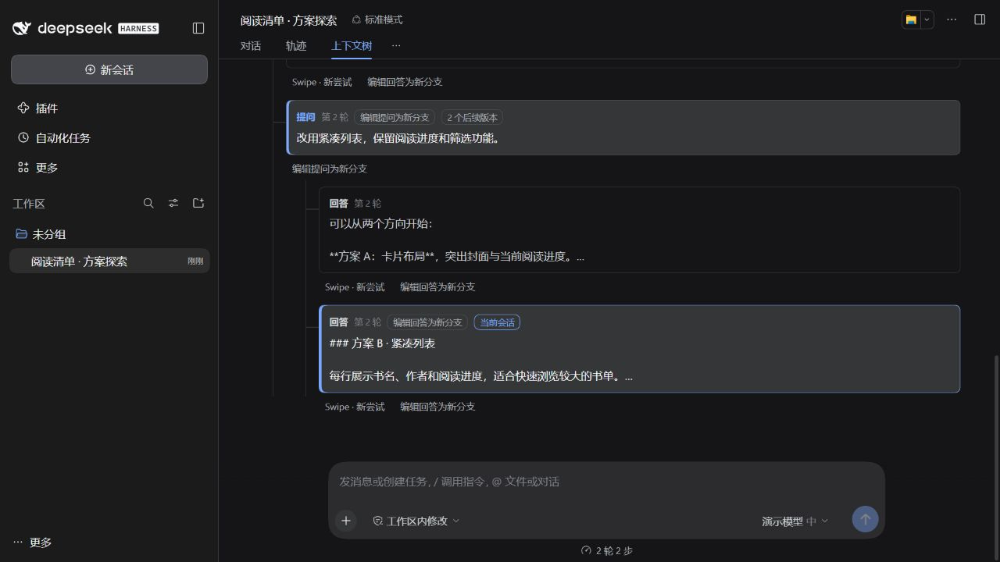
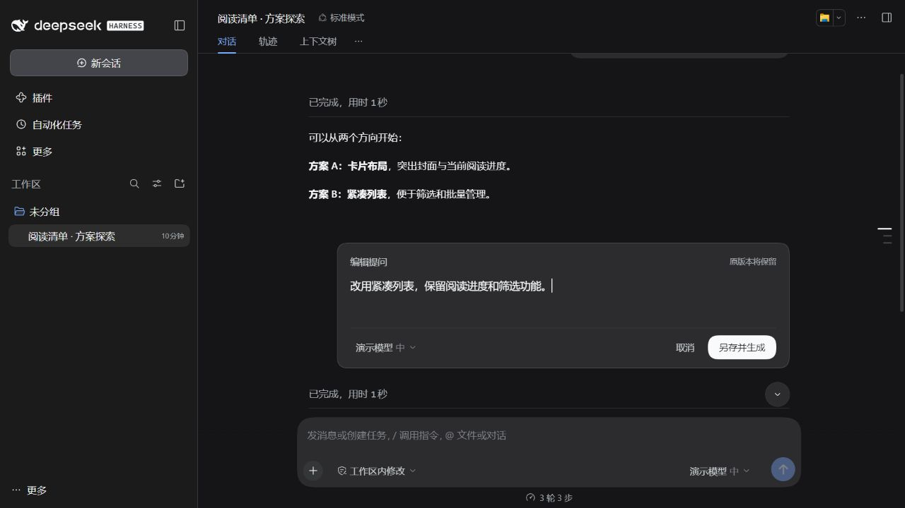

# dsh-context-tree

适用于 DeepSeek Harness 的上下文分支管理插件。支持在对话任意楼层创建独立尝试、编辑分支，并在保留完整上下文分支的前提下随时切回与探索。

## 主要特性

- **任意楼层分支重试 (Swipe)**：在已结束的对话轮次旁发起新尝试，新分支沿用分叉点之前的完整前文，原分支及其后续内容保持完整。
- **消息编辑分支**：
  - **编辑提问**：保留附件并修改用户输入，在新分支生成新回复。
  - **编辑回答**：将模型回复修改为指定文本并保存为独立分支，无需再次调用模型。
- **独立消息编辑实现**：采用独立实现的消息编辑支持（lib/message-edits.js），无外部旧编辑插件代码依赖，仅保留历史数据格式兼容。
- **树形上下文导航**：提供版本切换器（`‹ 版本 / 总数 ›`）与上下文树视图，支持直观浏览分支结构、点击路径切换至对应会话。
- **原生模型与思考等级选择**：内置分支模型选择器，复用 DSH 原生控件，支持为新分支独立指定模型与思考档位。
- **侧栏聚合管理**：同树派生分支在侧边栏自动聚合为单一入口，显示汇总状态与更新时间，并记住上次选择的分支；跨工作区分支与归档分支保留原生独立管理入口。

## 界面预览


*上下文树视图：直观查看分支衍生关系并快速切换目标会话*


*编辑消息分支：调整提问或回答并直接沉淀为独立新分支*

## 行为与边界说明

- **分支数据独立**：各分支作为原生独立 Session 保存，采用追加式记录，历史可完整复现与跨重启恢复。
- **工作区与副作用不回滚**：切换分支仅切换会话对话上下文，已修改的工作区文件、已执行工具的外部改动不会自动回滚。
- **插件兼容**：兼容 Mnemon 的共享长期记忆，并为 Billion 提供未改动前文的摘要复用适配。
- **生成锁约束**：当前分支正在生成时，需等待完成或停止后再发起新尝试；其他已完成分支仍可正常打开。

## 安装

适用于 DeepSeek Harness 0.2.1 系列桌面版，使用发布包无需安装 Node.js、Git 或自行编译。

从 [GitHub Releases](https://github.com/SaigyoujiYusora/dsh-context-tree/releases/latest) 下载 `dsh-context-tree-0.1.14.tgz`。完全退出 DSH 后，在下载目录打开 PowerShell 7，执行：

```powershell
dsh plugin --profile desktop add "./dsh-context-tree-0.1.14.tgz" --ignore-scripts
```

安装完成后重新启动 DSH。

如果找不到 `dsh` 命令，将最后一行替换为 Windows 默认安装路径：

```powershell
& "$env:LOCALAPPDATA/Programs/DeepSeek Harness/resources/runtime/cli/bin/dsh.cmd" plugin --profile desktop add "./dsh-context-tree-0.1.14.tgz" --ignore-scripts
```

## 开发与测试

从源码构建需要 Node.js 24+ 和 Git：

```powershell
git clone https://github.com/SaigyoujiYusora/dsh-context-tree.git
Set-Location "./dsh-context-tree"

# 安装依赖并自动构建客户端注入脚本
npm ci

# 手动构建客户端脚本 (输出至 lib/client.js)
npm run build

# 运行测试套件
npm test

# 打包并安装（先完全退出 DSH）
$pluginPackage = npm pack --ignore-scripts --silent
dsh plugin --profile desktop add "./$pluginPackage" --ignore-scripts
```

> **兼容性说明**：兼容 DeepSeek Harness `0.2.1` 系列（范围 `>=0.2.1-0 <0.2.2-0`，已在 `0.2.1-rc.2` 与 `0.2.1-rc.3` 验证）。
>
> 单元测试依赖 DSH 宿主内部模块。运行 `npm test` 时需设置环境变量 `DSH_HOST_MODULES` 指向宿主运行时的 `node_modules`，桌面版可通过宿主 Electron Node 模式配合 `test/host-loader.mjs` 解析依赖。

## 致谢

- 感谢 [Unintendedz/dsh-conversation-tree](https://github.com/Unintendedz/dsh-conversation-tree)（MIT 许可）。本插件的树形界面布局、部分交互与分支导航基于其 0.8.0 版本改编，许可证见 [LICENSES/dsh-conversation-tree-MIT.txt](LICENSES/dsh-conversation-tree-MIT.txt)，归属细节见 [NOTICE.md](NOTICE.md)。
